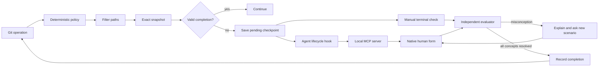

# Architecture

Sphinx has one local engine and thin Git/agent integrations. It runs no daemon and no Sphinx backend service.

## Modules

| Module | Responsibility |
| --- | --- |
| `config.js` | Defaults, global/repository settings, canonical/legacy policy discovery, private JSON files, credentials |
| `repo-config.js` | Exclusive creation of repository policy and ignore files, preserving existing files |
| `ignore.js` | Sensitive-file exclusions and project/global patterns |
| `git.js` | Deterministic triggers, filtered object/index evidence, snapshot identities |
| `routing.js` | Line/file/path tiers, depth-dependent question ceilings, and user-selected model routes |
| `evaluator.js` | Fresh CLI evaluator processes, question/rubric schemas, output validation |
| `openrouter.js` | Authenticated structured-output API requests and free-only price limits |
| `sessions.js` | Durable checkpoints, locks, progress, call budgets, expiration |
| `presentations.js` | Session-bound queues for native questionnaire presentation, without code or answers |
| `native-check.js` | Direct human-form assessment loop, queue claims, cancellation, and summary-only results |
| `mcp.js` | Bounded stdio JSON-RPC transport, form elicitation, and lifecycle tool responses |
| `install.js` | Reversible hook chaining, agent configuration, coverage checks |
| `agent.js` | SessionStart guidance and Claude shell-session tagging for native questionnaires |
| `cli.js` | Onboarding, terminal interview, public JSON protocol, hook entry points |
| `terminal.js`, `help.js`, `prompts.js` | Terminal presentation, contextual command help, and guided selections |

## Repository policy and terminal interaction

Machine-wide settings live in `$SPHINX_HOME/config.json`. A repository's canonical policy is JSON stored in `.sphinxconfig`. If that file is absent, the loader accepts legacy `.sphinx.json`. When both are present, canonical policy wins without merging the legacy file. Repository policy can control triggers, question depth, blocking mode, and exclusions; model routes, authentication, and usage budgets remain machine-wide. Repository exclusions add to machine-wide exclusions.

`sphinx init` guides the user through event, branch, depth, mode, and remote choices. Branch defaults come from effective configuration rather than the currently checked-out branch. The initializer writes `.sphinxconfig` and `.sphinxignore` only when absent. It can copy a legacy policy into the canonical file while retaining the original. Rerunning setup preserves existing files and does not silently apply new flags over them.

Initialization does not install hooks, change global settings, resolve remote Git state, or invoke a model. Machine-wide integration is a separate, once-per-machine operation. A repository with a competing `core.hooksPath` needs the explicit `install --repo` compatibility step.

Human terminal output provides a compact ASCII mark, explanatory selections, and progress/context for assessments. Color and layout adapt to terminal capabilities. Every public command supports its own help through `sphinx <command> --help` and `sphinx help <command>`. `--json` output and hook protocols bypass decorative output; they remain suitable for coding agents, pipes, and tests. `NO_COLOR` disables color; redirected output is uncolored by default. Help and read-only status/configuration commands never invoke an evaluator.

## Native questionnaire transport

The Git hook saves a pending assessment and a presentation request, then exits without inference. A coding-agent lifecycle hook calls the local `sphinx_checkpoint` MCP tool. Its only arguments are repository context and host/session identifiers: `cwd`, `host`, `hookEvent`, and `hostSession`. It accepts no questions or human answers from the development model.

The controller claims queued work and uses MCP `elicitation/create` to present a flat form. The user can answer, learn, dispute, or pause. Responses return directly to Sphinx and its independent evaluator. Questions, feedback, and responses are not included in the tool result; the development model receives only allowlisted status, assessment IDs, progress, usage counts, and static retry guidance. The client controls how forms appear and may retain its own interaction logs.

The stdio server negotiates protocol `2025-11-25` or legacy `2025-06-18`, supports both modern `elicitation.form` and legacy empty elicitation capabilities, and correlates each form to an active tool request. Unsupported clients leave queued checks untouched and consume no inference. No queued work returns an empty hook response, including on clients without form support. JSON messages and accepted field values are bounded and validated; malformed answers, cancellation, disconnection, or timeouts cannot mark a check complete.

Advertised form support does not guarantee the client will display a request: client approval policies may cancel it. Codex 0.162.1's `never` policy does so unless its host enables full-access form input for a user thread. Sphinx preserves the pending assessment and does not alter the client's approval settings. Terminal checks remain available. Completion guidance retries only blocked Git operations; advisory operations must not be repeated.

A paused or dismissed presentation is consumed while its assessment remains pending. Unrelated shell commands therefore do not reopen it. A new Git attempt queues presentation again and resumes existing progress. Session identifiers let the integration find requests from commands that change directories or use `git -C`; Codex supplies its thread ID, and the Claude SessionStart hook appends a Sphinx session tag through `CLAUDE_ENV_FILE`. Outside native hosts, `sphinx check` provides the terminal interview using the same assessment state.

## Independent context

The evaluator receives only the filtered snapshot evidence, allowed citation paths, and assessment instructions. A grading request also receives the precommitted rubric and human answer. Source and answers are explicitly untrusted data.

OpenRouter runs without tools. Codex/Claude run fresh, ephemeral sessions in a temporary directory, with custom instructions, project-context discovery disabled, and tool integrations disabled by supported CLI settings. The original coding transcript is never loaded. `SPHINX_EVALUATOR=1` prevents recursive Sphinx lifecycle hooks. CLI authentication is reused without copying secrets into the repository or prompts.

These adapters depend on recent CLI features. Unsupported flags or managed settings that conflict with isolation may cause a failure; Sphinx does not retry in a less isolated mode. Provider adapters need continued compatibility testing.

## State and cost

The existing line, file-count, and consequential-path rules deterministically select a small, medium, or large tier before inference. A consequential path promotes even a tiny patch to large; file count alone does not establish simplicity. That tier selects the configured evaluator route and, together with question depth, the maximum initial question count:

| Tier | Relaxed | Standard | Thorough |
| --- | --- | --- | --- |
| Small | 1 | 1 | 1 |
| Medium | 2 | 2 | 3 |
| Large | 2 | 3 | 5 |

The evaluator must return at least one question and may use fewer than the ceiling when fewer distinct behaviors are supported. It must not invent extra concerns to fill the budget. Model routes remain independent of depth. `maxOutputTokens` is preserved across all tiers; OpenRouter enforces it, while CLI evaluators receive concise-output instructions and local process limits.

Snapshot IDs include repository identity, exact objects/index, destination, effective policy, and ignore-policy hash. Ignored files affect immutable object identity but their contents never enter evidence. Before evaluating and before completing an assessment, Sphinx revalidates the local source/index and policies. The eventual Git hook compares a fresh destination snapshot to the completion record, so a changed remote base also invalidates reuse.

`pending → active → passed` is the main state sequence. Wrong answers teach the missed concept and replace its question with a new transfer scenario without advancing progress or adding another concept. Retries can exceed the initial question count, subject to the model-call budget. Ambiguity remains active. Calls are charged against the local request budget before invocation, including failed attempts. Per-session file locks prevent simultaneous grading and duplicate generation; expected question IDs reject stale responses. Native cancellation is checked before committing grading progress or completion. Private state files use mode `0600`; public JSON deliberately omits rubrics and full source evidence.

Successful records expire after 24 hours by default. No automatic background inference, provider escalation, or generation retry occurs. A local completion record is a workflow convenience, not a cryptographic attestation.

## Installation

A global Git `core.hooksPath` points to Sphinx dispatchers. Existing hooks are chained with their arguments and input preserved. Unrelated hook protocols are forwarded directly so interactive/streaming hooks are not buffered. Repository-level overrides need `sphinx install --repo` to wrap the repository's effective hook directory.

The installation manifest tracks original settings and the exact files/handlers Sphinx created. Uninstall restores only configuration it still owns; subsequent edits are preserved. Both integrations register a local stdio MCP server and inject guidance at session start. Codex uses a native `PostToolUse` MCP tool hook for `Bash`; Claude uses `PostToolUse` and `PostToolUseFailure` for `Bash`. The Git hook remains the canonical local checkpoint; native hooks only present already queued work. Evaluator sessions tagged `SPHINX_EVALUATOR=1` skip both queueing and native presentation.

## References

- [Git hook protocols](https://git-scm.com/docs/githooks)
- [Git central hooks path](https://git-scm.com/docs/git-config#Documentation/git-config.txt-corehooksPath)
- [Codex hooks and trust](https://learn.chatgpt.com/docs/hooks)
- [Codex CLI reference](https://learn.chatgpt.com/docs/cli/reference)
- [Claude Code hooks](https://code.claude.com/docs/en/hooks)
- [Claude Code CLI reference](https://code.claude.com/docs/en/cli-reference)
- [MCP form elicitation](https://modelcontextprotocol.io/specification/2025-11-25/client/elicitation)
- [MCP initialization and protocol negotiation](https://modelcontextprotocol.io/specification/2025-11-25/basic/lifecycle)
- [MCP stdio transport](https://modelcontextprotocol.io/specification/2025-11-25/basic/transports)
- [OpenRouter structured outputs](https://openrouter.ai/docs/guides/features/structured-outputs)
- [OpenRouter provider price limits](https://openrouter.ai/docs/guides/routing/provider-selection)
