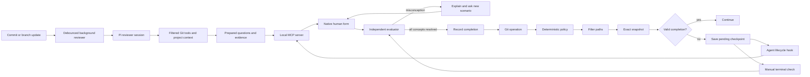

# Architecture

Sphinx has one local checkpoint engine and thin Git/agent integrations. It embeds `@earendil-works/pi-coding-agent` 1.2.0 for investigative reviewer sessions and requires Node.js 22.19+. Short-lived detached workers prepare reviews; there is no permanent daemon or Sphinx backend service.

## Modules

| Module | Responsibility |
| --- | --- |
| `config.js` | Defaults, global/repository settings, canonical/legacy policy discovery, private JSON files, credentials |
| `repo-config.js` | Exclusive creation of repository policy and ignore files, preserving existing files |
| `ignore.js` | Sensitive-file exclusions and project/global patterns |
| `git.js` | Deterministic triggers, filtered object/index evidence, snapshot identities |
| `routing.js` | Line/file/path tiers, depth-dependent question ceilings, and user-selected model routes |
| `evaluator.js` | Fresh CLI evaluator processes, question/rubric schemas, output validation |
| `reviewer.js` | Pi reviewer integration, exact observation archive, assessment validation, review budgets |
| `pi-runtime.js` | Isolated Pi SDK session, model-transport bridge, native compaction, cancellation, cleanup |
| `review-workspace.js` | Filtered immutable file, diff, listing, and search tools |
| `repo-context.js` | Bounded project background, ignore checks, context identity |
| `preparation.js` | Detached scheduling, debounce, exact cache matching, failure status |
| `openrouter.js` | Authenticated structured-output API requests and free-only price limits |
| `sessions.js` | Durable checkpoints, locks, progress, call budgets, expiration |
| `presentations.js` | Session-bound queues and hook-owned presentation markers, without code or answers |
| `git-gate.js` | Waiting Git gate, exact snapshot/receipt revalidation, batch ownership, and fallback |
| `git-interview.js` | Bounded separate-terminal interview while the original Git invocation waits |
| `native-check.js` | Direct human-form assessment loop, queue claims, cancellation, and summary-only results |
| `mcp.js` | Bounded stdio JSON-RPC transport, form elicitation, and lifecycle tool responses |
| `install.js` | Reversible hook chaining, agent configuration, coverage checks |
| `agent.js` | SessionStart guidance and Claude shell-session tagging for native questionnaires |
| `pi-integration.js` | Pi extension installation, native dialogs, and deterministic queued-check presentation |
| `lifecycle-integrations.js`, `cursor-hook.js` | Cursor/OpenCode installation, deterministic terminal launch, and status-only client results |
| `terminal-launch.js`, `terminal-worker.js` | Dedicated terminal selection, exact checkpoint execution, window deduplication, and worker status |
| `activation.js`, `activation-worker.js` | Fresh coding-client sessions after installation, prompt-free launch, and startup acknowledgment |
| `cli.js` | Onboarding, terminal interview, public JSON protocol, hook entry points |
| `terminal.js`, `help.js`, `prompts.js` | Terminal presentation, contextual command help, and guided selections |

## Repository policy and terminal interaction

Machine-wide settings live in `$SPHINX_HOME/config.json`. A repository's canonical policy is JSON stored in `.sphinxconfig`. If that file is absent, the loader accepts legacy `.sphinx.json`. When both are present, canonical policy wins without merging the legacy file. Repository policy can control triggers, question depth, blocking mode, and exclusions; model routes, authentication, and usage budgets remain machine-wide. Repository exclusions add to machine-wide exclusions.

`sphinx init` guides the user through event, branch, depth, mode, remote, and project-context choices. Branch defaults come from effective configuration rather than the currently checked-out branch. The initializer writes `.sphinxconfig`, `.sphinxignore`, and `.sphinxcontext.md` only when absent. It can copy a legacy policy into the canonical file while retaining the original. Rerunning setup preserves existing files and does not silently apply new flags over them.

Initialization does not install hooks, change global settings, resolve remote Git state, or invoke a model. Machine-wide integration is a separate, once-per-machine operation. A repository with a competing `core.hooksPath` needs the explicit `install --repo` compatibility step.

Human terminal output provides a compact ASCII mark, explanatory selections, and progress/context for assessments. Color and layout adapt to terminal capabilities. Every public command supports its own help through `sphinx <command> --help` and `sphinx help <command>`. `--json` output and hook protocols bypass decorative output; they remain suitable for coding agents, pipes, and tests. `NO_COLOR` disables color; redirected output is uncolored by default. Help and read-only status/configuration commands never invoke an evaluator. Reviewer dependencies are loaded only when an investigation starts, keeping ordinary Git gating and CLI inspection independent of reviewer initialization.

## Native questionnaire transport

A blocking Git hook saves pending assessments and hook-owned presentation requests, then opens the separate Sphinx terminal and waits. These requests are invisible to native after-tool callbacks. Native dialogs and terminals share a per-checkpoint reservation, so an already-open questionnaire is reused instead of opening a second interview. The questionnaire owns inference; the Git hook never reads human answers or uses Git stdin for the interview. After completion it reloads policy and revalidates every original snapshot and receipt, including previously approved destinations, before returning zero to the same Git process. Existing hooks run once before snapshot collection; commands, refspecs, force flags, stdin, and remotes are never reconstructed or replayed. Git retains its own remote-update concurrency checks.

Closing, pausing, cancellation, a stale snapshot, missing receipt, or deadline causes nonzero exit and cleanup of the entire hook-owned presentation batch. If no terminal can open, the hook stops Git and queues the native/manual fallback instead. Advisory mode proceeds immediately and queues its existing advisory presentation. Codex and Claude Code lifecycle hooks call the local `sphinx_checkpoint` MCP tool only for this fallback/advisory queue. Its only arguments are repository context and host/session identifiers: `cwd`, `host`, `hookEvent`, and `hostSession`. It accepts no questions or human answers from the development model.

The controller claims queued work and uses MCP `elicitation/create` to present a flat form. The user can answer, learn, dispute, or pause. Responses return directly to Sphinx and its independent evaluator. Questions, feedback, and responses are not included in the tool result; the development model receives only allowlisted status, assessment IDs, progress, usage counts, and static retry guidance. The client controls how forms appear and may retain its own interaction logs.

The stdio server negotiates protocol `2025-11-25` or legacy `2025-06-18`, supports both modern `elicitation.form` and legacy empty elicitation capabilities, and correlates each form to an active tool request. Unsupported clients leave queued checks untouched and consume no inference. No queued work returns an empty hook response, including on clients without form support. JSON messages and accepted field values are bounded and validated; malformed answers, cancellation, disconnection, or timeouts cannot mark a check complete.

Advertised form support does not guarantee the client will display a request: client approval policies may cancel it. Codex 0.162.1's `never` policy does so unless its host enables full-access form input for a user thread. Sphinx preserves the pending assessment and does not alter the client's approval settings. Terminal checks remain available. Completion guidance retries only blocked Git operations; advisory operations must not be repeated.

A paused or dismissed presentation is consumed while its assessment remains pending. Unrelated shell commands therefore do not reopen it. A new Git attempt queues presentation again and resumes existing progress. Session identifiers let the integration find requests from commands that change directories or use `git -C`; Codex supplies its thread ID, and the Claude SessionStart hook appends a Sphinx session tag through `CLAUDE_ENV_FILE`. Outside native hosts, `sphinx check` provides the terminal interview using the same assessment state.

Pi's development-client integration is a separate local extension from the embedded reviewer runtime. It observes built-in `bash` and `powershell` results, then calls the same questionnaire controller for queued Git requests. `ctx.ui.select` presents Answer, Learn, Dispute, and Pause; `ctx.ui.input` collects the person's response. Only a fixed status message is appended to the shell result. Questions, feedback, and human answers never enter the coding transcript. Interactive or dialog-capable RPC mode is required; noninteractive modes preserve pending work for a terminal check. Pi's built-in shell session ID associates requests across `cd` and `git -C`.

Cursor and OpenCode adapters deterministically inspect queued presentation metadata after shell tools and open a dedicated Sphinx terminal. A private worker starts the installed CLI with `check --id <assessment-id>` in the queued repository. The human answers directly in that terminal; the CLI owns evaluator calls, progress, and completion. The client hook waits for a status-only result. This fallback cannot resume Git after it has exited; guidance permits a new invocation only after checking that the original operation failed at Sphinx, and forbids repeating waiting, successful, or advisory operations. Questions, feedback, answer keys, and human responses never pass through the client tool result. Cursor receives a context note; OpenCode receives a shell-result note and a TUI toast when available. Session environment tags support cross-directory routing.

The launcher uses macOS Terminal through a fixed AppleScript program, or a detected Linux terminal with a graphical display. WSL requires a working graphical terminal; SSH, CI, headless operation, launch failure, and denied macOS Terminal automation permission use the manual `sphinx check` fallback. Private status files and launch tokens track the exact assessment and worker/CLI process IDs. An active interview is reused; the same presentation token cannot repeatedly reopen a paused or failed attempt on unrelated tool events. A new Git attempt permits another presentation. The direct Git interview and fallback client hooks wait up to 25 minutes; an unfinished interview then yields pending status without instructing the development model to poll. Host shell or remote connection timeouts can stop Git earlier. A late receipt never revives or replays an exited Git operation. Hook-owned terminal launches carry normalized Git index/directory context through the private one-shot environment channel, preserving temporary indexes used by partial commits. No Git context or credentials enter launch argv or records. Cursor user hooks apply only to local sessions. Other clients can use the generic Git gate and terminal interview without an adapter.

## Independent investigation and compaction

Version 2 snapshots contain change metadata and pinned Git identities, not a bundled patch. Before the first model request, Sphinx reads up to eight initial diff pages through the filtered immutable workspace, within one quarter of `maxContextBytes`. These local reads consume no model calls. They enter the same exact evidence archive as subsequent tool observations, alongside a filtered path manifest, statistics, and `.sphinxcontext.md`. Header-only or unavailable observations cannot satisfy the changed-code evidence requirement; if no usable evidence can be loaded within these limits, review stops before inference. The agent chooses `read_diff`, `read_file`, `list_files`, and `search` calls for missing ranges and dependencies. Tools filter paths before reading immutable blobs, reject unsafe paths and symlinks, and return bounded pages with explicit continuation information. Unchanged callers, tests, and dependencies are accessible at the pinned revision. Staged checkpoints retain index object identities.

The [Pi SDK](https://pi.dev/docs/latest/sdk) owns an in-memory reviewer session, the agent/tool loop, and native compaction. Sphinx registers only its filtered immutable workspace tools, supplies explicit project context, and disables ambient resource discovery and general-purpose tools. The session never loads the development transcript, project agent instructions, or unrelated Pi resources. `SPHINX_EVALUATOR=1` prevents recursive Sphinx hooks.

OpenRouter supplies model responses with native function calls. The Codex/Claude compatibility routes use fresh isolated CLI invocations as model transports underneath Pi. Structured model responses become Pi tool requests; Pi schedules the registered Sphinx tools and carries the conversation into the next request. These routes reuse CLI authentication without copying secrets into prompts. They do not run a persistent Codex or Claude reviewer session, or delegate isolation to those clients' native tools.

Every request includes bounded project context (maximum 16,000 bytes). Context is descriptive data, not evaluator policy, and its claims must be checked against code. The current project file is hashed into checkpoint identity; an excluded context file is not opened.

Pi's [native compaction](https://pi.dev/docs/latest/compaction) summarizes older conversation history and rebuilds the active context. Sphinx separately archives exact observations with IDs, paths, revisions, and ranges under a fixed byte budget. Compaction can shorten Pi's transcript without changing this archive; a model summary cannot replace code evidence. Final questions must cite inspected paths backed by archived observations. Grading receives the question's selected original evidence, rubric, project context, and verbatim human answer.

Sphinx enforces `maxContextBytes` on serialized review context: prompts, tools, and schemas. Provider transport metadata is outside this count; it is not a byte limit on the complete HTTP body or the whole Git patch. Pi's estimated context threshold leaves reserve space for compaction, while tool pages and the evidence archive have separate bounds. Byte-based token estimates drive Pi's context management, particularly for CLI transports without reliable token reporting; these estimates are not billed usage totals. If the next review context cannot fit, the assessment remains incomplete. Every actual model request, including native compaction, is charged before invocation against the same checkpoint budget. Automatic retries and cache warming are disabled; an error never triggers a paid-provider fallback.

These adapters depend on recent CLI features. Unsupported flags or managed settings that conflict with isolation may cause a failure; Sphinx does not retry in a less isolated mode. Provider adapters need continued compatibility testing.

## Background preparation

Post-commit, post-merge, post-rewrite, and post-checkout dispatchers preserve original hook behavior, then schedule a detached worker without waiting for inference. A 1.5-second default debounce and job identities coalesce repeated work. Local push/upstream tracking metadata predicts the destination and remote base; missing tracking history is a cold-review case, not a reason to fetch or speculate automatically.

Workers call the same session preparation path as foreground checks. Exact source/destination/policy/ignore/context matches reuse questions and evidence. A foreground check waits for an in-progress review instead of duplicating requests. Superseded workers and changed snapshots cannot install valid prepared work. Preparation never opens a questionnaire or creates completion. Failures have safe status messages and require explicit retry. `backgroundPreparation: false` disables scheduling; repositories can opt out but cannot override a machine-wide opt-out.

## State and cost

The existing line, file-count, and consequential-path rules deterministically select a small, medium, or large tier before inference. A consequential path promotes even a tiny patch to large; file count alone does not establish simplicity. That tier selects the configured evaluator route and, together with question depth, the maximum initial question count:

| Tier | Relaxed | Standard | Thorough |
| --- | --- | --- | --- |
| Small | 1 | 1 | 1 |
| Medium | 2 | 2 | 3 |
| Large | 2 | 3 | 5 |

The evaluator must return at least one question and may use fewer than the ceiling when fewer distinct behaviors are supported. It must not invent extra concerns to fill the budget. Model routes remain independent of depth. `maxOutputTokens` is preserved across all tiers; OpenRouter enforces it, while CLI evaluators receive concise-output instructions and local process limits.

Snapshot IDs include repository identity, exact objects/index, destination, effective policy, ignore-policy hash, and project-context hash. Ignored files affect immutable object identity but their contents never enter evidence. Before model calls, tool use, and completion, Sphinx revalidates local source/index and policies. The eventual Git hook compares a fresh destination snapshot to the completion record, so a changed remote base also invalidates reuse.

`pending → active → passed` is the main state sequence. Wrong answers teach the missed concept and replace its question with a new transfer scenario without advancing progress or adding another concept. Retries can exceed the initial question count, subject to the model-call budget. Ambiguity remains active. Calls are charged against the local request budget before invocation, including failed attempts. Per-session file locks prevent simultaneous grading and duplicate generation; expected question IDs reject stale responses. Native cancellation is checked before committing grading progress or completion. Private state files use mode `0600`; public JSON deliberately omits rubrics and full source evidence.

Successful records expire after 24 hours by default. Background investigation is enabled by default and shares the assessment's 20-request default ceiling. Each actual inference request, including compaction and failures, is charged before invocation. Sphinx reserves grading calls and bounds the Pi reviewer by `agentMaxTurns`, serialized review-context bytes, tool-page bytes, and a whole-investigation deadline. Small and medium reviews have additional ceilings of 3 and 5 calls. On the final review request, native `tool_choice` forces `finish_review` while retaining earlier tool definitions for history compatibility. The transport and reviewer reject any other returned call; the CLI response schema also allows only finalization; Pi cannot compact away that reserved request. Missing evidence still fails the review.

`maxModelCalls` is an operational ceiling, separate from assessment identity. Its canonical policy-hash value stays at the historical default of 10, preserving those existing checkpoint IDs when the ceiling changes; older checkpoints originally hashed with a non-10 custom limit require a fresh checkpoint. All other policy fields remain bound. The session store reloads the global ceiling under its lock before resume, grading, and every actual model request. A changed configured ceiling replaces the absolute limit and records a budget-change entry without resetting calls, questions, attempts, review evidence, or completion. Lowering below used calls blocks further inference. Prior explicit retry allowances remain in effect until the configured ceiling changes; changing it to 20 means a total limit of 20. `sphinx config --max-model-calls <1-100>` saves the global ceiling without reinstalling or invoking a model.

For a one-attempt extension without changing the global ceiling, `check --id <id> --retry-review` and the equivalent human choice in the interactive recovery menu remain available for failed, questionless checkpoints. Under its session lock, it validates the unchanged policy/snapshot, records prior attempt usage, and allows at most `maxModelCalls` additional requests. Total calls remain cumulative, and the public usage limit reflects the extension. Provider errors expose only numeric status and allowlisted error categories, never raw response messages or metadata. When enough calls remain for review plus grading, the interactive menu offers a retry within that allowance; otherwise it offers a new allowance. Pause is always the default, and every further failure requires a fresh choice. Known setup/auth/context failures and zero-request preflight failures do not offer another spending attempt; stale content or policy stops recovery. The terminal stays alive while the human decides, allowing the original Git hook to remain waiting within its deadline. JSON commands keep their noninteractive failure behavior. Ordinary resuming and background work adopt an explicitly edited global ceiling but never authorize an additional per-attempt allowance; active or passed questionnaires cannot be restarted. Provider escalation remains explicit. A local completion record is a workflow convenience, not a cryptographic attestation.

## Installation

A global Git `core.hooksPath` points to Sphinx dispatchers. Existing hooks are chained with their arguments and input preserved. Unrelated hook protocols are forwarded directly so interactive/streaming hooks are not buffered. Repository-level overrides need `sphinx install --repo` to wrap the repository's effective hook directory.

The installation manifest tracks original settings and the exact files/handlers Sphinx created. Uninstall restores only configuration it still owns; subsequent edits are preserved. `--agents auto` detects Codex, Claude, Pi, Cursor, and OpenCode from executables, configuration directories, or an existing installation record. An explicit comma-separated subset selects integrations; `none` selects Git-only setup.

Codex and Claude integrations register a local stdio MCP server and inject guidance at session start. Codex uses a native `PostToolUse` MCP tool hook for `Bash`; Claude uses `PostToolUse` and `PostToolUseFailure` for `Bash`. Pi installs `extensions/sphinx.js` under `PI_CODING_AGENT_DIR` or `~/.pi/agent`; a new session or `/reload` loads it. Cursor adds `sessionStart`, `postToolUse`, and `postToolUseFailure` handlers to `~/.cursor/hooks.json`. OpenCode installs `plugins/sphinx.js` in its configuration directory, honoring `OPENCODE_CONFIG_DIR` or `XDG_CONFIG_HOME`, without rewriting `opencode.json` or JSONC settings.

After configuration succeeds, interactive `sphinx install` opens the selected installed clients by default. `--no-launch` defers activation; `install --yes` opens clients only with explicit `--launch`. `sphinx activate` opens already-configured integrations without reinstalling, and `--agents codex,claude,pi,cursor,opencode` can select a configured subset. `--json` returns launch outcomes without decorative output. Repository-only `install --repo` remains a hook-compatibility operation.

Activation starts fresh Codex, Claude Code, Pi, and OpenCode CLI sessions, or a new Cursor editor window. It supplies no initial model prompt, invokes no Sphinx evaluator, and does not restart existing processes. Missing executables or headless environments produce a focused manual-launch fallback. A successful launch means the client opened, not that its MCP connection, form support, or hook trust has been verified. Native client trust decisions remain with the human; Codex's hook browser must be opened with `/hooks`. Sphinx does not pass a slash command as an initial model prompt or use an undocumented approval deep link.

The Git hook remains the canonical local checkpoint. Client integrations consume already queued work; they do not let a model decide whether a check is required. Evaluator sessions tagged `SPHINX_EVALUATOR=1` skip queueing and client presentation. Tests redirect integration homes and never install into a developer's real configuration.

## References

- [Pi SDK](https://pi.dev/docs/latest/sdk)
- [Pi compaction](https://pi.dev/docs/latest/compaction)
- [Pi SDK full-control example](https://github.com/earendil-works/pi/blob/main/packages/coding-agent/examples/sdk/12-full-control.ts)
- [Pi extensions](https://pi.dev/docs/latest/extensions)
- [Cursor hooks](https://cursor.com/docs/hooks)
- [Cursor MCP support](https://cursor.com/docs/mcp)
- [OpenCode plugins](https://opencode.ai/docs/plugins/)
- [Git hook protocols](https://git-scm.com/docs/githooks)
- [Git central hooks path](https://git-scm.com/docs/git-config#Documentation/git-config.txt-corehooksPath)
- [Codex hooks and trust](https://learn.chatgpt.com/docs/hooks)
- [Codex CLI reference](https://learn.chatgpt.com/docs/cli/reference)
- [Claude Code hooks](https://code.claude.com/docs/en/hooks)
- [Claude Code CLI reference](https://code.claude.com/docs/en/cli-reference)
- [MCP form elicitation](https://modelcontextprotocol.io/specification/2025-11-25/client/elicitation)
- [MCP initialization and protocol negotiation](https://modelcontextprotocol.io/specification/2025-11-25/basic/lifecycle)
- [MCP stdio transport](https://modelcontextprotocol.io/specification/2025-11-25/basic/transports)
- [OpenRouter structured outputs](https://openrouter.ai/docs/guides/features/structured-outputs)
- [OpenRouter tool calling](https://openrouter.ai/docs/guides/features/tool-calling)
- [OpenRouter provider price limits](https://openrouter.ai/docs/guides/routing/provider-selection)
